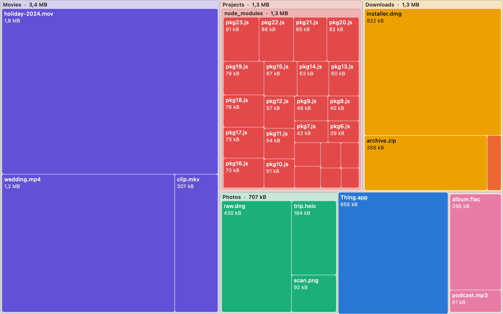

<div align="center">

# Diskova

**Find out what is eating your Mac's disk — and throw it away from the same window.**

[](https://github.com/erenahmettt/diskova/actions/workflows/ci.yml)
[](LICENSE)
[](#requirements)
[](#requirements)



</div>

---

"My Mac is full" is the most common complaint there is, and macOS answers it
with a single bar chart and a category called **Other**. Diskova answers it
properly: it measures a folder or a whole disk and draws every file as a
rectangle whose area is its share of the space. The thing filling your disk is
the biggest shape on the screen. You can then move it to the Trash without
leaving the window.

There are good tools that do this. The polished one costs money and is closed
source; the free ones were written fifteen years ago and look it. Diskova is
native SwiftUI, open source, and free.

## What it does

- **Maps any folder or volume** as a [squarified treemap](#the-treemap), with
  folders drawn nested inside one another — so you can see at a glance whether
  a 40 GB folder is one enormous file or a million small ones.
- **Tells the truth about sizes.** Hard links are counted once, symlinks are
  never followed, other volumes are not wandered onto, and sizes are the space
  actually allocated on disk. [Why that matters](#getting-the-numbers-right).
- **Highlights what is safe to delete.** `node_modules`, `DerivedData`,
  `__pycache__`, caches and build output get their own colour and a note saying
  they regenerate themselves.
- **Never deletes anything.** Removal goes through the Trash, always. The map
  then corrects itself instantly — no second scan.
- **Says when it was blocked.** If macOS privacy protection hid part of the
  disk, Diskova says so and offers to open the right settings pane, instead of
  quietly reporting a smaller number.
- **Works without relying on colour.** Every tile is labelled, the legend is
  always on screen, and there is a [measured colour-blind-safe
  palette](#colour-and-accessibility).
- **Speaks English and Turkish.**

## Install

### Download a release

Grab the `.zip` from [Releases](https://github.com/erenahmettt/diskova/releases),
unzip it, and drag `Diskova.app` to `/Applications`.

**Then read the next section before double-clicking it**, because macOS will
refuse to open it and the reason is not obvious.

#### Why macOS blocks it, and what to do

Diskova is ad-hoc signed but **not notarised**. Notarising means paying Apple
$99 a year for a Developer ID, and this is a free weekend project. macOS
therefore treats the app as unidentified and refuses the first launch.

The old advice for this — right-click the app and choose *Open* — **no longer
works**. Apple removed that bypass in macOS 15 Sequoia. There are two ways
through on a current system:

**Either** clear the quarantine flag before you open it, which skips the whole
dance:

```bash
xattr -dr com.apple.quarantine /Applications/Diskova.app
```

**Or** use the official route: double-click Diskova and let it be blocked, then
open **System Settings › Privacy & Security**, scroll down to the *Security*
section, and click **Open Anyway** next to the message about Diskova. Confirm,
and enter your password. Do this soon after the blocked launch — the button
only appears for a while afterwards.

Do not turn Gatekeeper off system-wide to solve this. It would weaken every
other app on your Mac to install one.

If none of that appeals to you — and it is a perfectly reasonable thing to
refuse — build from source instead. It needs no Apple account and takes about
thirty seconds.

### Build it yourself

```bash
git clone https://github.com/erenahmettt/diskova.git
```

```bash
cd diskova && open Diskova.xcodeproj
```

Press ⌘R. Or from the command line:

```bash
xcodebuild -scheme Diskova -configuration Release build
```

### Verifying a download

Every release ships a `.sha256` file beside the archive. To check that the zip
you downloaded is the one the build produced:

```bash
shasum -a 256 -c Diskova-0.1.0.zip.sha256
```

The archive is built by [GitHub Actions](.github/workflows/release.yml) from a
tagged commit, so the whole path from source to binary is public.

### Full Disk Access

Diskova works fine without it for your own files. To scan `/` or other users'
folders, grant it Full Disk Access in **System Settings › Privacy & Security**.
Diskova will tell you when it has been blocked and offer a button that takes you
there.

## How it works

### The treemap

Area is the only honest way to show "share of a total" for thousands of items at
once — a list makes you add numbers up in your head, and a pie chart falls apart
past six slices.

The naive treemap slices the rectangle one way, then slices each slice the other
way. It produces slivers: you cannot compare their areas by eye, read a label in
them, or reliably click one. Diskova uses the **squarified** algorithm (Bruls,
Huizing and van Wijk, 2000), which packs items into rows and extends a row only
while doing so keeps the worst aspect ratio in that row from getting worse. The
result is tiles that are close to square.

The layout is a pure function from sizes to rectangles, which is why it can be
held to properties rather than to a screenshot. The tests assert that the
rectangles fill the canvas exactly, never overlap, never escape, have areas
proportional to the sizes, and stay under a 5:1 aspect ratio on input where
slice-and-dice produces 20:1 slivers.

### Scanning

A full startup disk is a few million entries, and almost all of the work is
waiting on the filesystem rather than computing.

- The **top two levels** of the tree are walked in parallel with a task group;
  deeper levels recurse on whichever task got there. Going wide at the top is
  where the win is — `~/Library`, `/Applications` and `/System` can all be read
  at once — while recursing sequentially below that avoids spawning a task per
  folder on a disk with 200,000 of them.
- Sizes come from the **directory listing itself**, which lets the kernel batch
  the attribute lookups instead of `stat`-ing every file afterwards.
- Counters live in **one actor**, updated once per folder in a batch rather than
  once per file.
- The finished tree is **immutable**, so handing it from the scanner to the UI
  costs nothing and needs no lock. Deleting something rebuilds only the folders
  along one path and shares every other subtree, which is why the map updates
  the instant you trash a file instead of making you scan again.

### Getting the numbers right

Most of the difficulty in a disk analyser is not speed, it is not lying:

| Trap | What Diskova does |
|---|---|
| **Hard links** — macOS uses them heavily in system folders and Time Machine snapshots | Counts the bytes once. Without this, totals can exceed the size of the drive. |
| **Symbolic links** | Never followed. Following them means both double counting and infinite loops on a cycle. |
| **Mount points** | Not crossed by default, so scanning your startup disk does not wander onto an external drive. |
| **Logical vs allocated size** | Reports space allocated on disk — block rounding, compression and resource forks included — because that is the number that changes when you delete the file. |
| **Folders you cannot read** | Reported, not swallowed. Silently under-reporting looks exactly like a correct answer. |
| **Bundles** | An app is one 12 GB item, not 40,000 files. Switchable. |

Each of these has a test that creates the real thing in a temporary directory —
a genuine hard link, a genuine symlink loop, a genuine `.app` — and checks the
scanner's answer.

### Colour and accessibility

A treemap is the hardest case for a categorical palette. In a bar chart only
neighbouring series touch; in a treemap **any two tiles can end up side by
side**, so the palette has to hold up across every pair, not just adjacent ones.

So the colours were measured rather than chosen by eye, using perceptual
distance in OKLab (ΔE ×100) under simulated protanopia, deuteranopia and
tritanopia:

| Palette | Worst pair, colour-blind | Worst pair, normal vision |
|---|---|---|
| Detailed — 8 categories | ΔE 3.2 light / 1.6 dark | ΔE 7.1 |
| Colour-blind safe — 4 groups | ΔE 13.0 light / 6.9 dark | ΔE 19.6 light / 19.3 dark |

The thresholds are ΔE ≥ 8 for colour blindness and ≥ 15 for normal vision. A
search over the candidate hues found that **four is the largest set that can
pass all pairs** — no re-ordering fixes it, because in a treemap ordering does
not constrain adjacency.

Rather than pretend otherwise, Diskova:

1. **Never lets colour identify a tile on its own.** Every tile with room shows
   its name and size, the hovered tile is named in the status bar, the selected
   one is described in the inspector, and the legend pairs every colour with an
   icon and a label.
2. **Ships the four-colour set as a first-class setting**, which passes every
   check in both light and dark mode.

Dark mode values are chosen for the dark surface, not derived by flipping the
light ones. The sidebar list is the keyboard-navigable, VoiceOver-readable
version of everything the canvas draws.

## Keyboard

| | |
|---|---|
| ⌘O | Scan a folder |
| ⌘R | Rescan |
| ⌘↑ | Go up a level |
| ⌘↓ | Open the selected folder |
| ⌘⇧R | Reveal selection in Finder |
| ⌘⇧C | Copy path |
| ⌘⌫ | Move selection to the Trash |

Double-click a tile to open it. Right-click for everything else.

## Requirements

- macOS 14 Sonoma or later
- Xcode 16 or later to build (Swift 6 language mode)

## Development

```bash
xcodebuild -scheme Diskova -destination 'platform=macOS' test
```

Regenerate the app icon after changing `Scripts/generate-icon.swift`:

```bash
swift Scripts/generate-icon.swift
```

Regenerate the picture at the top of this file:

```bash
TEST_RUNNER_DISKOVA_SAMPLE_OUTPUT=$PWD/docs/sample-treemap.png xcodebuild -scheme Diskova -destination 'platform=macOS' test -only-testing:DiskovaTests/TreemapRenderingTests
```

See [CONTRIBUTING.md](CONTRIBUTING.md) — it lists the jobs that are a good first
pull request.

## Roadmap

- Quick Look preview with the space bar
- Filter the map by category from the legend
- Compare two scans to see what grew
- Remember a scan so it can be reopened without rescanning
- Homebrew cask

## Licence

[MIT](LICENSE).
